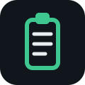

<p align="center">
  
</p>

<h1 align="center">ClipVault</h1>

<p align="center">
  <b>Privacy-first, offline clipboard history for Windows and Linux.</b><br>
  Built in Rust with egui. No account, no cloud, no telemetry.
</p>

<p align="center">
  <a href="https://github.com/Ryzellx/clipvault/actions/workflows/ci.yml"></a>
  <a href="https://github.com/Ryzellx/clipvault/releases/latest"></a>
  
  
  
</p>

<p align="center">
  <a href="https://github.com/Ryzellx/clipvault/releases/latest">⬇ Download</a>
  ·
  <a href="docs/CLI.md">CLI reference</a>
  ·
  <a href="docs/ARCHITECTURE.md">Architecture</a>
  ·
  <a href="CHANGELOG.md">Changelog</a>
</p>

---

<p align="center">
  ClipVault watches your clipboard <i>only when you let it</i>, keeps a searchable<br>
  history of text and images on your own disk, and lets you copy any earlier<br>
  item back with one click. Sensitive content such as API keys, tokens, and<br>
  passwords is <b>not stored by default</b> — ClipVault keeps a redacted<br>
  placeholder and the content hash only, and tells you it did so.
</p>

## ✨ Features

<div align="center">

| Feature | What it does |
|---|---|
| 📋 Clipboard history | Text and images, with BLAKE3 hash deduplication |
| 🔍 Full-text search | SQLite FTS5, plus favorites, pinning, tags, filters |
| ↩️ Restore | Copy any earlier item back to the clipboard |
| 🔒 Sensitive-content detection | API keys, tokens, private keys, passwords — withheld by default, opt-in to store |
| ⏸️ Pause & exclusions | Pause monitoring, per-application exclusions, automatic expiration |
| 💾 Storage limits | Automatic cleanup, database integrity checks |
| 📦 Export & import | History as JSON, with the same CLI |
| ⌨️ CLI | `status`, `history`, `search`, `copy`, `pin`, `delete`, `clear`, `pause`, `resume`, `export`, `import`, `doctor` |
| 🛡️ Private storage | 0700 data directory, 0600 files on Unix |

</div>

## 📸 Screenshots

<p align="center">
  <i>No screenshots yet — real screenshots of the running app will be added to <code>docs/screenshots/</code> once captured. None are faked here.</i>
</p>

## 📥 Install

<div align="center">

| From a release | From source |
|---|---|
| Download the archive for your platform from the [latest release](https://github.com/Ryzellx/clipvault/releases/latest) and run the binary. | Requires a stable Rust toolchain (1.85+) and, on Linux, X11/GL dev libraries (`libxcb`, `libxkbcommon`, `libGL`). |

</div>

```sh
git clone https://github.com/Ryzellx/clipvault
cd clipvault
cargo build --release
./target/release/clipvault
```

<p align="center">
  ClipVault stores its data in <code>~/.local/share/clipvault/</code> on Linux<br>
  and <code>%LOCALAPPDATA%\ClipVault\</code> on Windows.
</p>

## 🚀 Quick start

1. Run `clipvault`. Copy some text. It appears in History.
2. Click **Copy back** on any item to put it on the clipboard again.
3. Pin items you want to keep; pinned items survive cleanup and clearing.
4. Open Settings to change retention, storage limits, and whether sensitive content may be stored.

## ⌨️ CLI

See the full [CLI reference](docs/CLI.md). Quick examples:

```sh
clipvault status
clipvault history --limit 20
clipvault search "invoice"
clipvault copy 42
clipvault pin 42
clipvault export --file backup.json
clipvault import backup.json
clipvault doctor
```

## 🏗️ Architecture

See [docs/ARCHITECTURE.md](docs/ARCHITECTURE.md). In short: an arboard-based clipboard monitor thread feeds a SQLite metadata store with a separate content-addressed blob directory; the egui app and the CLI share the same `Store` type.

## 🔐 Privacy and security

<p align="center">
  Everything is local. ClipVault makes no network requests.<br>
  Clipboard content never appears in logs. No keylogging, no keyboard monitoring of any kind.
</p>

- Sensitive content is detected with local patterns and withheld unless you explicitly allow storing it in Settings.
- Data files are created with private Unix permissions.

## ⚠️ Known limitations

- **Wayland (Linux):** persistent clipboard access is unavailable on Wayland compositors. ClipVault captures reliably on X11; on Wayland it can only see clipboard content while it owns the selection, so history may be incomplete. This is stated in the app and in `clipvault doctor`.
- **Rich text:** formatted text is stored as plain text in this release.
- **Application exclusion:** on Linux the active application is not reliably detectable from the clipboard alone, so exclusion by process name is best-effort and currently limited to Windows detection paths.

## 🤝 Contributing

Issues and pull requests are welcome. Run `cargo fmt`, `cargo clippy --all-targets`, and `cargo test` before submitting.

---

<p align="center">
  MIT License — see <a href="LICENSE">LICENSE</a>
</p>
